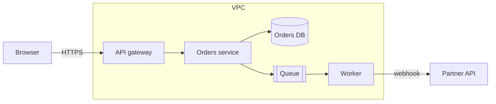

# Threat Modeling

Four questions (Shostack): What are we building? What can go wrong?
What are we going to do about it? Did we do a good job?

## When to Use This Skill
- New service, external integration, auth change, or handling sensitive data
- Before a security review or compliance audit
- After an incident to find related weaknesses

## 1. Model the system
Draw a data flow diagram: external entities, processes, data stores,
data flows, and **trust boundaries** (internet ↔ edge, app ↔ DB,
tenant ↔ tenant, user ↔ admin).


List assets: credentials, PII, payment data, admin capabilities, availability.

## 2. Find threats (STRIDE per element / flow)
| Threat | Question | Typical mitigation |
|--------|----------|--------------------|
| **S**poofing | Can someone pretend to be a user/service? | AuthN, mTLS, signed webhooks |
| **T**ampering | Can data be modified in transit/at rest? | TLS, integrity checks, authZ on writes |
| **R**epudiation | Can actions be denied later? | Audit logs with identity |
| **I**nformation disclosure | Can data leak? | AuthZ, encryption, minimal responses |
| **D**enial of service | Can it be overwhelmed? | Rate limits, quotas, timeouts |
| **E**levation of privilege | Can a user gain more rights? | Least privilege, input validation, sandboxing |

Focus hardest where flows cross trust boundaries. Add abuse cases:
"a malicious tenant uploads a 5 GB file", "a webhook URL points to 169.254.169.254".

## 3. Rate and decide
- Rate each threat: likelihood × impact (high/medium/low is enough).
- Decide: mitigate, accept (with owner and rationale), transfer, or eliminate the feature.
- Turn mitigations into tickets with acceptance criteria and tests.

## 4. Validate
- Confirm mitigations shipped; add security tests.
- Revisit the model when the design changes.

## Output template
```markdown
## Threat model: <feature> (<date>)
Scope / DFD link / assets
| # | Element | STRIDE | Threat | Risk | Mitigation | Ticket | Status |
```

## Rules
- Keep it lightweight: an hour with the team beats a perfect document nobody reads.
- Include developers who build the feature; security facilitates.
- Store the model next to the design doc/ADR.
